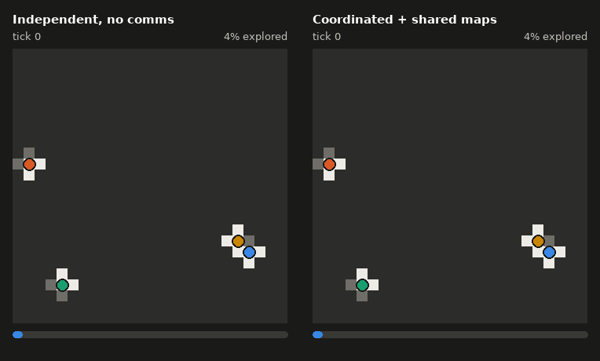
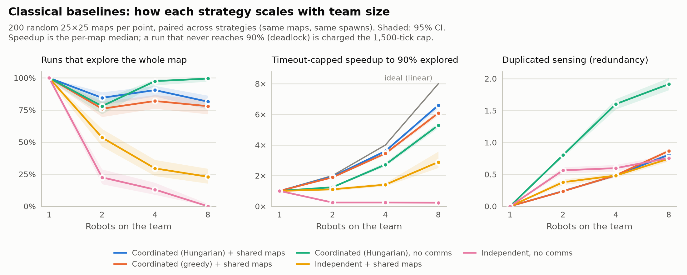
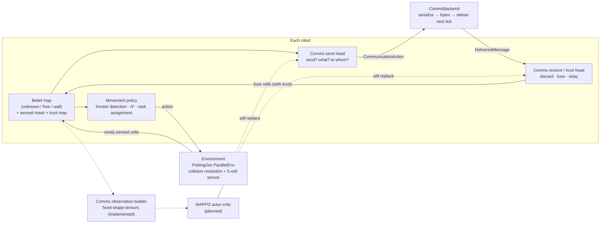
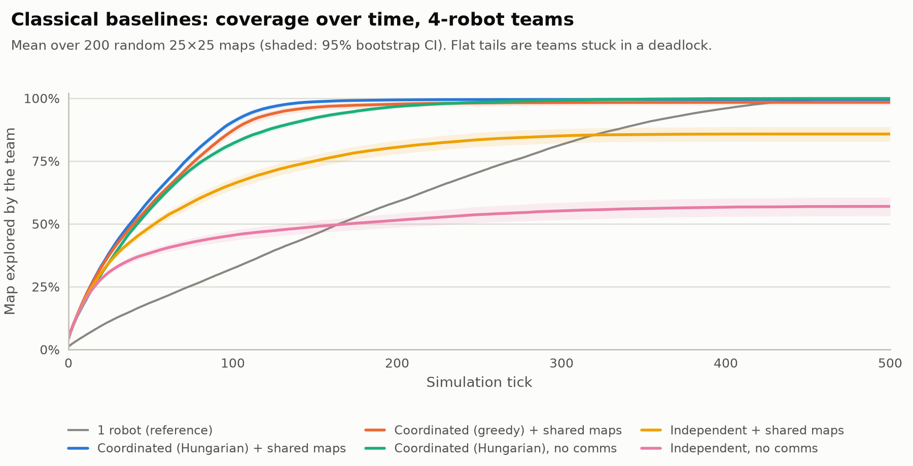
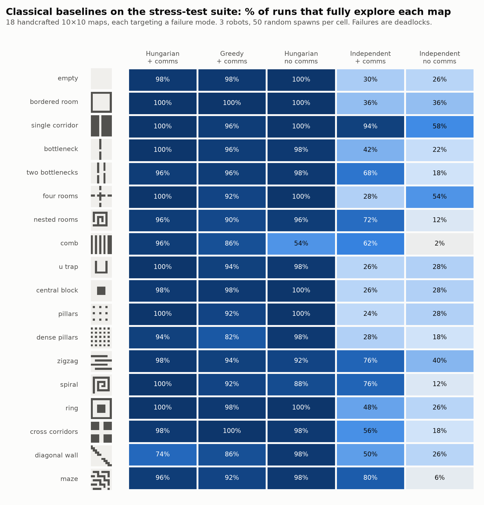

# SABLE

**Swarm Autonomy under Bandwidth-Limited Exploration.** A multi-robot simulator and research testbed
for decentralized exploration of unknown, GPS-denied environments when the radio links between robots
are limited, delayed, or unreliable.

> **Research question:** can a small, decentralized policy decide *when* to communicate, *what* to send,
> and *how much to trust* what it receives, while keeping exploration performance under tight compute,
> memory, energy, and bandwidth limits?



*Same map, same four start positions. **Left:** each robot independently heads for its nearest unexplored
area. Two pairs of robots end up blocking each other head-on and the team stalls at 45%. **Right:** robots
share the cells they've mapped and split frontiers with an assignment solver; the team finishes in 123 ticks.
Dark cells are still unknown to the team. (Random map, seed 7; `python benchmarks/make_demo.py`.)*

**Status:** the environment, classical exploration baselines, communication stack, and benchmark suite are
implemented. The learned communication policy (MAPPO, multi-agent PPO) is in progress: its fixed-shape
observation builder exists, but the actor-critic and training loop do not yet. **Every result in this README
is a classical baseline** that the learned policy will be compared against.

SABLE keeps the well-understood, safety-relevant parts of autonomy classical: occupancy mapping, frontier
detection, A\* path planning, collision handling, and task assignment. Learning is reserved for the part
that is hard to specify by hand: what robots say to each other, when, and how much they trust it.

## Results

Classical baselines on 200 random 25×25 maps, team sizes 1, 2, 4, and 8. Every strategy runs on the same maps
from the same start positions, so comparisons are paired.

- **6.59× timeout-capped speedup** to 90% coverage with 8 coordinated robots sharing maps (95% CI 6.39–6.71;
  ideal 8×). With 4 robots: 3.60×.
- **90.5%** of 4-robot coordinated teams that share maps explore the entire map.
- **97.5%** of 4-robot coordinated teams that do *not* share maps explore the entire map. That is *higher*
  than with sharing (paired McNemar p = 0.004). At 8 robots the gap widens to 99.5% vs. 81.5% (p < 10⁻⁹).
- **Independent exploration falls apart as teams grow.** Full-map completion drops from 100% with one robot
  to 13% with 4 and 0% with 8. Map sharing helps (29.5% and 23%) but does not fix it.
- **Every unfinished run ended in a movement deadlock**: robots blocking each other indefinitely, not
  exploring slowly.

That shared information can *lower* completion for coordinated teams is the most interesting result so far.
It suggests that what robots communicate, not just how much, shapes team behavior. See [Findings](#findings).

<picture>
  <source media="(prefers-color-scheme: dark)" srcset="assets/figures/scaling-dark.png">
  
</picture>

## Architecture

Each tick, every robot runs the same loop. There is no central planner or shared world model.



1. **Sense.** A robot observes its own cell and its four neighbors and records them in its private
   *belief map*. It never reads the ground-truth map.
2. **Plan.** The robot finds *frontiers* (known-free cells next to unknown space) and groups them into
   regions. It then either heads for the nearest one (independent) or solves a team-wide robot-to-region
   assignment and follows its own share (coordinated).
3. **Move.** All robots move simultaneously. If two robots request the same cell, request each other's cells,
   or form a cycle, none of them moves.
4. **Communicate.** The send head turns newly sensed cells into a message. The backend serializes it and
   delivers it on the next tick. The receive/trust head decides what to do with each delivered message.

### What is implemented today

| Layer | Current implementation | Status |
|---|---|---|
| Exploration and navigation | Frontier detection and clustering, BFS/A\* search, greedy and Hungarian frontier assignment | Implemented (classical) |
| Send head | `BroadcastNewCellsSender`: broadcast every newly sensed cell, skip when there is nothing new | Classical reference |
| Receive/trust head | `TrustAllReceiver`: fuse every message at trust 1.0. `RELAY` exists in the interface, but relayed messages are recorded, not forwarded | Classical reference |
| Transport | `PerfectBroadcastBackend`: lossless, unlimited bandwidth, next-tick delivery | Implemented; impaired backends planned |
| Learning interface | `build_comms_observation`: fixed-shape, masked `float32` tensors | Implemented, not yet consumed by a policy |
| MAPPO actor-critic and training | — | Planned |

**Decentralization model.** Each robot plans from its own occupancy belief. In every configuration,
including "no comms", **teammate positions are assumed known**: they are given to the planner directly,
not sent through the comms backend. The communication comparisons below therefore restrict
*occupancy-map exchange* only, not localization. The simulator computes all robots' decisions in one
process, but each decision reads only that robot's belief map plus teammate positions.

## Baseline comparison

**Setup.** The random maps use root seeds 0–199. The requested obstacle density is 0.3; the realized
density averages 0.45, because the generator keeps only the largest connected free region. That leaves
a mean of 344 open cells (range 189–386). Episodes are capped at 1,500 ticks. There are 4,000 episodes on
random maps and 4,500 on the handcrafted suite.

The five strategies form a 2×2 that separates *coordination* from *map sharing*, plus a cheaper
assignment rule:

| Strategy | How each robot picks a target | What robots exchange through the comms backend |
|---|---|---|
| **Independent, no comms** | nearest frontier (A\*) | nothing |
| **Independent + shared maps** | nearest frontier (A\*) | every newly sensed cell |
| **Coordinated (Hungarian), no comms** | min-total-cost robot→region assignment, computed on its own map | nothing (teammate positions are still known) |
| **Coordinated (Hungarian) + shared maps** | same, on a map extended by received cells | every newly sensed cell |
| **Coordinated (greedy) + shared maps** | greedy cost-based assignment (after Burgard et al.) | every newly sensed cell |

For the learned communication policy to count as an improvement over these baselines, it should match the
best baseline's exploration speed while sending fewer bytes, and keep that performance once the backend
starts dropping and delaying messages. Deadlock rates will also be compared against classical
deadlock-handling baselines (see [Roadmap](#roadmap)), not only against the strategies here.

### Coverage over time (4 robots)

<picture>
  <source media="(prefers-color-scheme: dark)" srcset="assets/figures/coverage_curves-dark.png">
  
</picture>

### 4-robot teams

| Strategy | Full-map completion | Timeout-capped speedup to 90% | Median ticks to 100%, finished runs only | Median ticks to 100%, timeout-inclusive | Duplicated sensing |
|---|---:|---:|---:|---:|---:|
| 1 robot (reference) | 100% | 1.00× | 445 | 445 | 0.00 |
| **Coordinated (Hungarian) + shared maps** | **90.5%** | **3.60×** | **128** | **131** | **0.48** |
| Coordinated (greedy) + shared maps | 82.0% | 3.45× | 132 | 138 | 0.49 |
| Coordinated (Hungarian), no comms | 97.5% | 2.72× | 257 | 264 | 1.60 |
| Independent + shared maps | 29.5% | 1.41× | 253 | 1,500 (cap) | 0.48 |
| Independent, no comms | 13.0% | 0.24× | 414 | 1,500 (cap) | 0.60 |
| MAPPO comms policy | *in progress* | | | | |

<sub>
<b>Full-map completion:</b> share of the 200 runs in which the team knows every open cell (Wilson 95% CIs in
<a href="benchmarks/summary.csv">summary.csv</a>).
<b>Timeout-capped speedup:</b> per map, ticks for the same strategy with one robot to reach 90% coverage,
divided by the team's ticks; median over maps, bootstrap 95% CI. Runs that never reach 90% are charged
1,500 ticks, so the "independent, no comms" value reflects failures rather than speed.
<b>Timeout-inclusive median:</b> unfinished runs are charged 1,500 ticks.
<b>Duplicated sensing:</b> average number of <i>extra</i> robots that physically sensed each cell
(0 = no overlap), measured at the end of each run, including runs that stopped in deadlock.
</sub>

### Findings

1. **Assignment produces near-linear speedup.** With shared maps, Hungarian assignment reaches 1.93× with 2
   robots, 3.60× with 4, and 6.59× with 8 (timeout-capped, to 90% coverage). Shared maps also cut
   duplicated sensing from 1.60 to 0.48. Among runs that finish, the median time to full coverage is 128 ticks
   with shared maps vs. 257 without. Timeout-inclusive medians tell the same story (131 vs. 264). Shared-map
   teams fail more often, though, so timeout-inclusive *means* are much closer at 4 robots (264 vs. 297)
   and reverse at 8 (338 vs. 155). Map sharing makes successful runs faster; it does not make every run faster.

2. **Shared information can increase deadlocks.** On the same maps and spawns, coordinated teams *without*
   map sharing finish more often: 97.5% vs. 90.5% with 4 robots (18 vs. 4 discordant maps, McNemar p = 0.004)
   and 99.5% vs. 81.5% with 8 (37 vs. 1, p < 10⁻⁹). With 2 robots the difference reverses but is not
   significant (78.0% vs. 84.5%, p = 0.09). The tests are in
   [`paired_tests.csv`](benchmarks/paired_tests.csv). One hypothesis, **not yet tested**: with shared maps,
   robots' beliefs are nearly identical (they differ only by each robot's most recent, not-yet-delivered
   sensing). So they compute nearly identical assignments, and a plan that routes two robots into each
   other is repeated every tick. Private maps would vary the plans and break that symmetry incidentally.
   Confirming or rejecting this needs a controlled ablation, for example shared maps with per-robot
   tie-break perturbation. If it holds, it suggests messages should carry more than map cells, such as
   claimed targets or intended paths. That is a research direction, not an established result.

3. **Independent exploration degrades with team size.** Without an assignment step, nothing stops two robots
   from choosing the same frontier or meeting head-on in a corridor. Completion falls to 22.5%, 13%, and 0%
   for 2, 4, and 8 robots. Map sharing significantly improves this (53.5%, 29.5%, 23%; McNemar p < 10⁻⁴ at
   every team size) but does not prevent the collapse.

4. **Deadlock is the dominant failure mode of the current system.** Every unfinished run ended with robots
   holding still while requesting moves the collision resolver rejects. The resolver rejects contested
   cells, swaps, and cycles. The planners are deterministic, so they request the same moves again every tick.
   This is a limitation of the present classical planners combined with conservative collision resolution.
   It is not evidence that learned communication is required. Classical remedies are natural comparison
   baselines and are on the roadmap: deterministic right-of-way (e.g. ID priority), randomized backoff, and
   recovery behaviors. An earlier version of the environment did use randomized tie-breaking. It was removed
   because its random-step recovery read the ground-truth map, and to keep movement arbitration out of the
   simulator. The current comms interface carries map cells only and cannot arbitrate movement.

5. **Message headers make up about half of the counted bytes.** Lossless broadcast delivers about 10 KB of
   cell payload per 4-robot episode, but about 20 KB of serialized frames (both counted once per
   recipient). A typical message carries about 2 cells (12 bytes) behind a 12-byte header. These counts cover
   the application-layer frame only: the claimed sender position and payload type still travel outside the
   frame, and no transport or link-layer overhead is modelled. Real network cost would therefore be higher.

### Stress-test suite

<picture>
  <source media="(prefers-color-scheme: dark)" srcset="assets/figures/stress_suite-dark.png">
  
</picture>

Eighteen handcrafted 10×10 maps, each targeting one failure mode: bottlenecks, dead-end combs, U-shaped
traps, spirals, loops, and mazes. Each cell is 3 robots with 50 random spawns (seeds 0–49) and a 400-tick cap.
Overall completion: Hungarian + shared maps 96.9%, Hungarian without comms 95.3%, greedy + shared maps 93.4%,
independent + shared maps 51.2%, independent without comms 25.4%. Independent robots deadlock even in an
empty room (74% of runs). The weakest coordinated cells are *comb* (54%, Hungarian without comms) and
*diagonal wall* (74%, Hungarian + shared maps).

## Design decisions

<details open>
<summary><b>1. Policies never see the true map</b></summary>

Policies receive only a robot's belief map and position, as read-only copies. The ground-truth map stays
inside the environment. An earlier collision-recovery step chose random moves using the true map; it was
replaced by a resolver that uses only robot positions. *Why:* if ground truth can leak in, a learned policy
will find and exploit it, invalidating every result built on top of it.
</details>

<details open>
<summary><b>2. Separate belief, first-hand sensing, and trust overlays</b></summary>

`belief_map` holds everything a robot believes, from any source. `sensed_mask` records only what its own
sensor saw. `trust_map` records confidence in cells learned over the radio. Fusing a message never overwrites
first-hand observations, never stamps trust on a conflicting value, and never touches `sensed_mask`.
*Why:* the redundancy metric measures duplicated physical sensing, not duplicated messages, and the trust
head gets per-cell provenance to reason over.
</details>

<details>
<summary><b>3. Simultaneous moves, resolved independently of robot order</b></summary>

`resolve_moves` computes a fixpoint: a robot moves only if its target is empty, or is vacated this tick by a
robot that itself moves. Contested cells, swaps, and cycles are rejected. The outcome does not depend on the
order robots are processed in. *Why:* sequential "robot 0 moves first" physics hides an arbitrary priority
rule inside the simulator. *Implication:* the simulator does not break ties, so deadlocks surface as
measurable failures of the planning and coordination layer instead of being silently resolved.
</details>

<details>
<summary><b>4. Explicit message serialization and byte accounting</b></summary>

Policies emit a `CommunicationAction` (skip, broadcast, or unicast, plus a payload). A `CommsBackend` decides
what is delivered and when. Messages are serialized to bytes (a little-endian header with sender ID, message
ID, and tick, followed by 6-byte cell records) and decoded on receipt. The receiver reads the decoded frame,
never the sender's live object. *Why:* bandwidth is measured in real bytes of a defined format, and lossy,
delayed, or adversarial backends can be added behind the same interface without changing any policy. This is
also where Go networking daemons will connect. *Limitation:* sender position and payload type are still
carried outside the serialized frame.
</details>

<details>
<summary><b>5. Minimum one-tick message delivery</b></summary>

A message sent at tick *t* is delivered at *t+1* at the earliest, so its age is always at least 1. *Why:*
instant delivery amounts to free telepathy and overstates the value of communication. Message age is also
one of the features in the trust head's observation.
</details>

<details>
<summary><b>6. Separate sender and receiver/trust policy heads</b></summary>

`CommsPolicy` combines a send head (`decide_send`) with a receive/trust head (`interpret` → discard, fuse at
trust *w*, or relay). The classical references are `BroadcastNewCellsSender` and `TrustAllReceiver`.
*Why:* each decision can be learned or replaced independently, and each learned head has a concrete
baseline to beat.
</details>

<details>
<summary><b>7. Decentralized frontier assignment</b></summary>

In the coordinated strategies, every robot runs the same assignment (greedy or Hungarian) on its own belief
map plus known teammate positions, and follows only its own share. With lossless sharing the beliefs are
nearly identical, so the plans approximate a central planner's. Under impaired communication (planned),
beliefs would diverge and plans could conflict. *Why:* this mirrors how a decentralized team behaves, and it
turns communication quality into a measurable coordination outcome. *Assumption:* positions are shared for
free (see the [decentralization model](#what-is-implemented-today)).
</details>

<details>
<summary><b>8. Independent RNG streams and reproducible episodes</b></summary>

One root seed is split with NumPy `SeedSequence` into independent streams for map, spawn, dynamics, comms,
and policy, so changing how much randomness one subsystem uses never shifts the others. The experiment
runner records the full seed manifest per episode, and timeouts and deadlocks stay in the statistics.
*Why:* any reported number can be replayed exactly, and failures can't be hidden by averaging only over
successful runs.
</details>

<details>
<summary><b>9. Fixed-shape, masked observations for learned communication</b></summary>

`build_comms_observation` converts a robot's state into fixed-size `float32` arrays: robot state, up to 16
delivered messages with a validity mask (age, size, novelty, agreement or conflict with the robot's belief,
claimed sender distance), communication resource use, and a frontier summary. Shapes come from one
`config.py`, and rows are sorted deterministically, so identical inputs give byte-identical tensors.
*Why:* MAPPO needs static shapes, and determinism makes training issues reproducible.
</details>

## Installation

```bash
git clone https://github.com/rohitmandapati/sable.git && cd sable
python -m venv .venv
source .venv/bin/activate          # Windows: .venv\Scripts\activate
pip install -r requirements.txt

python src/main.py                 # watch one robot explore (opens a pygame window)
python -m pytest -q                # run the test suite
```

Developed and tested with Python 3.13.

## Reproducing results

```bash
python benchmarks/run_benchmarks.py --seeds 200 --spawns 50   # 8,500 episodes (~4 min on 22 worker processes)
python benchmarks/make_figures.py                              # figures, summary.csv, paired_tests.csv
python benchmarks/make_demo.py --seed 7                        # the animation at the top
```

- **Source revision:** the results in this README were generated from `src/` at commit `9ff80fc`.
- **Parameters:** random maps use root seeds 0–199, team sizes 1/2/4/8, a 1,500-tick cap, and policy seed 0.
  The handcrafted suite uses 3 robots, spawn seeds 0–49, and a 400-tick cap. Bootstrap CIs use 4,000
  resamples with a fixed seed.
- **Outputs:** raw per-episode data (seeds, per-tick coverage, bytes, conflicts) goes to
  `results/benchmarks/*.jsonl`, which is git-ignored. Aggregates are in
  [`benchmarks/summary.csv`](benchmarks/summary.csv) and [`benchmarks/paired_tests.csv`](benchmarks/paired_tests.csv).
- **Early stopping:** an episode is stopped and labelled *deadlocked* once no robot has moved and no robot's
  belief has changed for 10 consecutive ticks. For the strategies benchmarked here, this state cannot
  change again: the policies are deterministic and stateless, belief cells never revert to unknown, and
  the lossless backend has nothing in flight once no new cells are sensed. That argument depends on those
  properties and would not hold for stochastic policies or lossy backends. As an empirical check, 21
  flagged episodes were re-run to a 900-tick cap with early stopping disabled; none made further progress.

## Tests

`python -m pytest -q` runs 142 tests (about 5 seconds). They cover map-generation invariants, PettingZoo API
conformance (PettingZoo's `parallel_api_test` is also run at import), the observation contract, collision
semantics (contests, swaps, cycles, chains), seed separation and full-episode replay, wire-format round trips
and malformed-frame rejection, next-tick delivery, trust fusion, comms policy behavior,
observation-tensor determinism, and that the runner never drops failed episodes. The benchmark scripts
themselves are not covered by tests.

## Project structure

```
src/
  environment.py        PettingZoo ParallelEnv: reset/step, sensing, collision resolution, metrics
  map.py, default_maps.py   procedural maps (connectivity-guaranteed) + 18 stress-test maps
  robot.py              per-robot belief map, sensed mask, trust map
  seeding.py            one root seed → independent map/spawn/dynamics/comms/policy streams
  planning/             frontier detection & clustering, BFS / A* search
  policy/               movement policies, incl. decentralized greedy & Hungarian assignment
  comms/                wire Message, CommsBackend, send policy, receive/trust policy
  learning/             fixed-shape observation tensors for the MAPPO comms policy
  runner/runner.py      batch experiment runner with per-episode records (CSV/JSONL)
  renderer.py, main.py  pygame visualizer and interactive demo
benchmarks/             benchmark sweep, figures, demo animation, summary.csv, paired_tests.csv
tests/                  unit + integration tests
assets/                 README animation and figures
```

## Roadmap

- [x] Grid world with procedural maps (guaranteed connected) and 18 handcrafted stress-test maps
- [x] PettingZoo `ParallelEnv` with simultaneous, order-independent collision resolution
- [x] Classical baselines: random walk, greedy-unknown, BFS/A\* frontier search, decentralized greedy and Hungarian frontier assignment
- [x] Comms stack: binary wire format, backend interface, send and receive/trust heads, lossless backend
- [x] Reproducible experiment harness and benchmark suite
- [ ] **(In progress)** MAPPO comms policy: observation builder done; PyTorch actor-critic and training loop next
- [ ] Classical deadlock-handling baselines: deterministic right-of-way, randomized backoff, recovery behaviors
- [ ] Controlled ablation of the shared-map deadlock effect, including an intent-sharing variant (`POSITION_INTENT` payload type is reserved)
- [ ] Impaired comms backends: packet loss, latency, bandwidth caps, range limits and partitions, spoofed senders
- [ ] Message relaying and full on-wire metadata accounting
- [ ] Network transport through Go daemons
- [ ] Port to Gazebo for physics-based simulation

## Limitations

- **Simplified world:** a 4-connected grid with perfect, noise-free 5-cell sensing and perfect localization.
- **Free positions:** teammate positions are known to every robot at no communication cost.
- **Ideal channel:** communication is lossless with unlimited bandwidth. Results under packet loss, latency,
  partitions, or adversarial senders are future work.
- **Unresolved deadlocks:** classical deadlock handling is not implemented, so completion rates reflect that.
- **Narrow benchmark range:** one map size and obstacle density for the random-map results, and
  deterministic policies only.
- **No learned policy yet:** no learned policy has been trained or evaluated.

## Tech stack

Python 3.13 · NumPy · Gymnasium · PettingZoo · Matplotlib · Pygame · pytest. *Planned:* PyTorch (MAPPO),
Go (network daemons), Gazebo (physics simulation).
